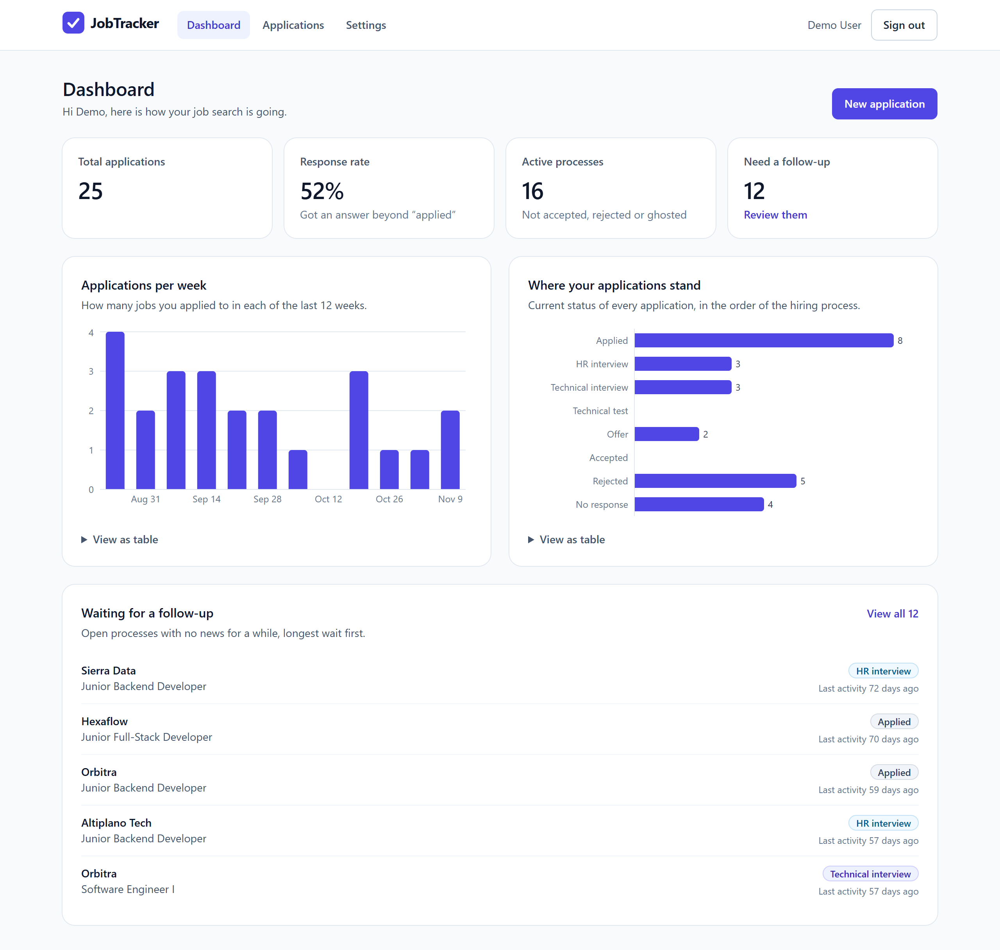
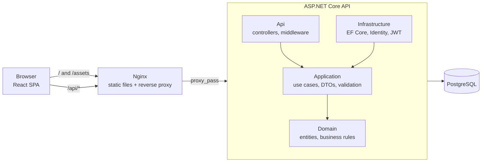
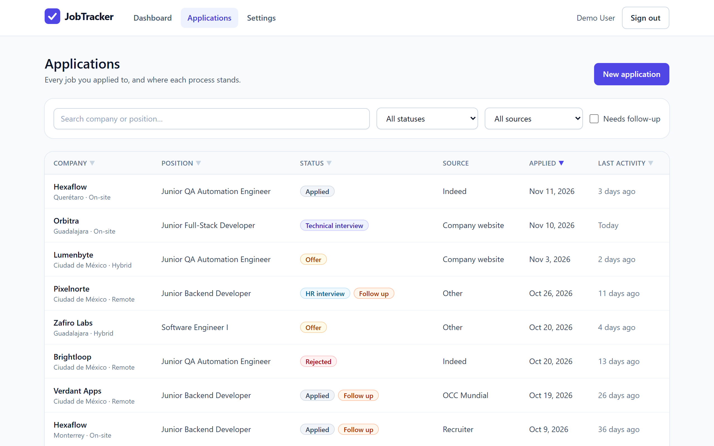
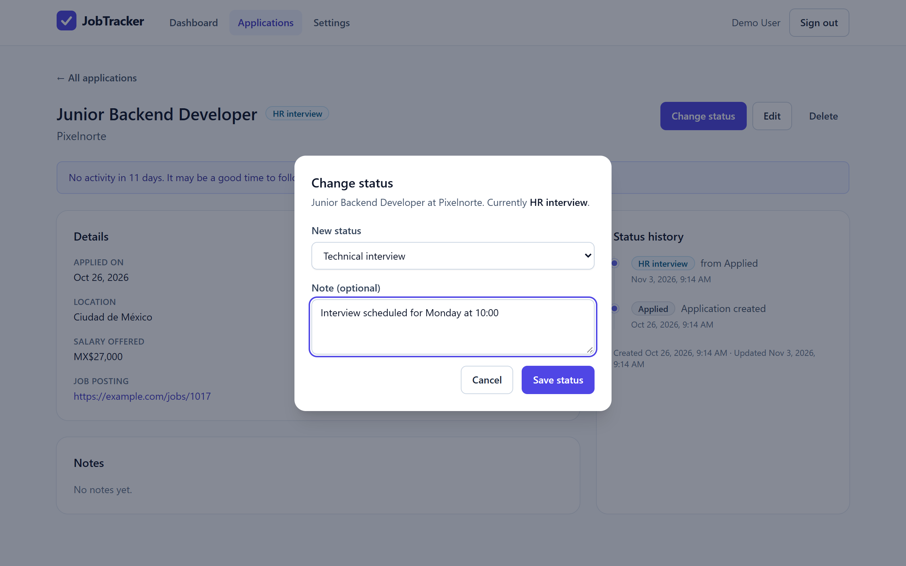
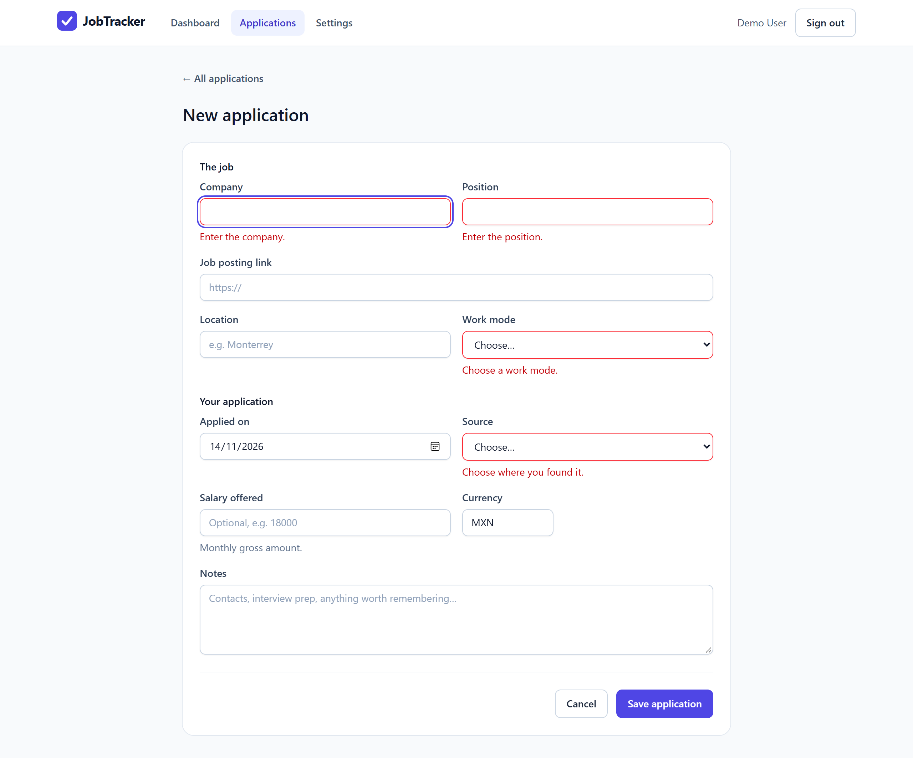
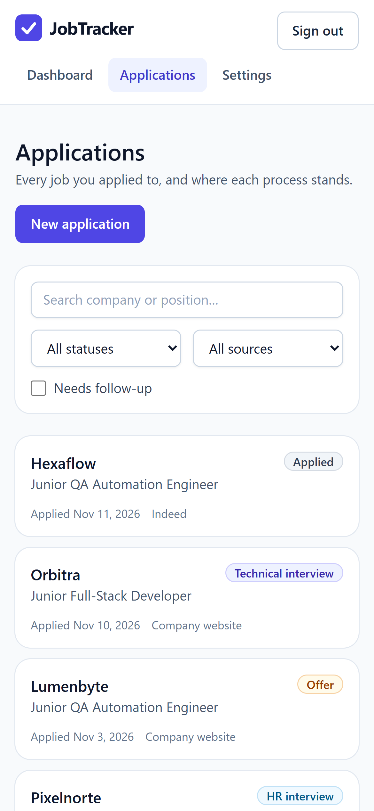
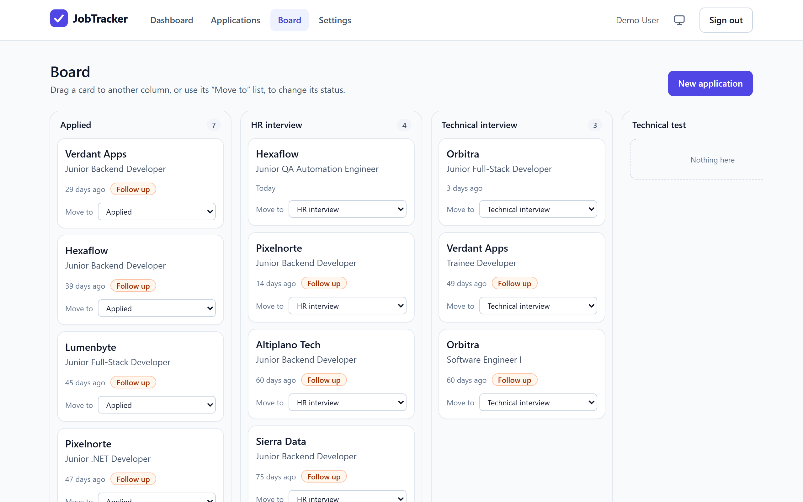
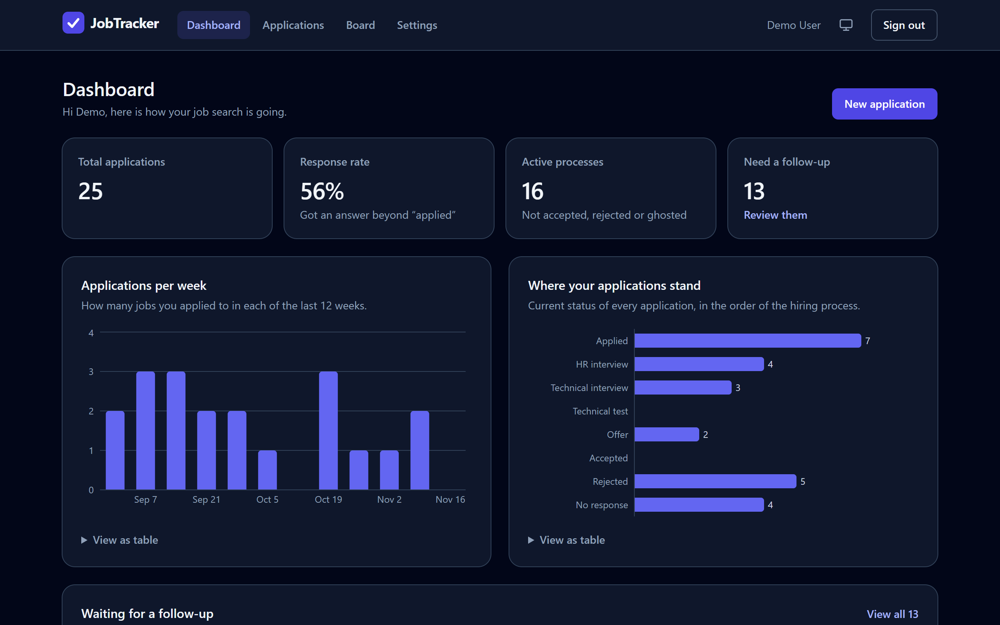

# JobTracker

[](https://github.com/Ed-Phoenix/JobTracker/actions/workflows/ci.yml)

A full-stack web app to keep track of job applications: where you applied, how each hiring process is going, and which companies you should follow up with.

Built with **ASP.NET Core 10**, **PostgreSQL** and **React + TypeScript**, with JWT authentication, automated tests on both ends and a one-command Docker setup.

**Live demo: [jobtracker-edphoenix.vercel.app](https://jobtracker-edphoenix.vercel.app)**. Create an account to try it; your data is visible only to you. The API runs on a free tier that sleeps when idle, so the first request after a while can take up to a minute. API reference: [/scalar](https://jobtracker-edphoenix.vercel.app/scalar).



## Features

- **Accounts** – sign up, sign in and sign out. Every user only ever sees their own data.
- **Applications** – company, position, job link, location, work mode (on-site / hybrid / remote), salary, date applied, source (LinkedIn, OCC, referral…) and notes.
- **Status history** – Applied → HR interview → Technical interview → Technical test → Offer → Accepted / Rejected / No response. Every change is recorded with an optional note.
- **Dashboard** – total applications, response rate, active processes, applications per week and the current status breakdown.
- **Search, filters, sorting and pagination** – all executed by the database, and kept in the URL so any view can be bookmarked or shared.
- **Follow-up reminders** – open applications with no activity for a configurable number of days are flagged.
- **Kanban board** – one column per status; drag a card to move it. The change shows instantly and is rolled back if the server rejects it. Every card also has a "Move to" list, so the board works without dragging.
- **Export** – download the current view (same search, filters and order) as CSV or Excel.
- **Dark mode** – light, dark or follow the system, remembered per browser.
- **Responsive and accessible** – works on phones, usable with a keyboard and a screen reader, with loading, empty and error states everywhere.

## Tech stack

| Area | Technology |
|---|---|
| Backend | ASP.NET Core 10 Web API (controllers), C# |
| Data | PostgreSQL 17, Entity Framework Core 10 (code-first migrations) |
| Auth | ASP.NET Core Identity, JWT access tokens, rotating refresh tokens in HttpOnly cookies |
| Validation & errors | FluentValidation, RFC 9457 ProblemDetails |
| Export | CSV (RFC 4180, written by hand) and Excel (ClosedXML) |
| API docs | OpenAPI + Scalar |
| Logging | Serilog |
| Frontend | React 19, TypeScript, Vite, Tailwind CSS v4 (design tokens for light/dark themes) |
| Frontend data & forms | TanStack Query, React Router, React Hook Form + Zod, Recharts, dnd-kit |
| Tests | xUnit, WebApplicationFactory + Testcontainers (real PostgreSQL); Vitest, Testing Library, MSW |
| DevOps | Docker (multi-stage images), docker-compose, Nginx, GitHub Actions |

## Architecture



The browser only talks to one origin. In development the Vite dev server proxies `/api`; in Docker, Nginx does. There is no CORS to configure, and the refresh-token cookie can be `SameSite=Strict`.

The backend is split into four projects whose references point inwards:

- **Domain** – `JobApplication` and its status history. Setters are private, so the rules ("you can only accept after an offer") live in one place and are unit-tested without a database.
- **Application** – use cases (`ApplicationsService`, `DashboardService`), DTOs and validators. It depends on interfaces (`IAppDbContext`, `ICurrentUser`) instead of concrete infrastructure.
- **Infrastructure** – EF Core `DbContext`, Fluent API mappings, migrations, Identity, token generation and demo-data seeding.
- **Api** – controllers that translate HTTP to use cases, global error handling, validation filter, rate limiting, OpenAPI.

```
JobTracker/
├─ backend/
│  ├─ src/        JobTracker.Domain · .Application · .Infrastructure · .Api
│  ├─ tests/      JobTracker.UnitTests · JobTracker.IntegrationTests
│  └─ Dockerfile
├─ frontend/
│  ├─ src/        app/ (routes, layout) · features/ (auth, applications, dashboard, settings)
│  │              components/ (shared UI) · lib/ (API client, helpers) · test/
│  ├─ nginx/      Nginx config for the production image
│  └─ Dockerfile
├─ docs/screenshots/
├─ docker-compose.yml
└─ .github/workflows/ci.yml
```

## Run it locally with Docker

Requirements: [Docker Desktop](https://www.docker.com/products/docker-desktop/) (or Docker Engine with Compose v2).

```bash
git clone https://github.com/Ed-Phoenix/JobTracker.git
cd JobTracker
cp .env.example .env    # then edit .env: set your own passwords and JWT_SIGNING_KEY
docker compose up --build
```

Open **http://localhost:8080** and sign in with the demo account:

- **Email:** `demo@jobtracker.dev`
- **Password:** the `DEMO_PASSWORD` you set in `.env`

The demo account comes with 25 sample applications. The interactive API reference is at **http://localhost:8080/scalar**.

To stop everything run `docker compose down`, or `docker compose down --volumes` to also delete the database.

## Deployment

The [live demo](https://jobtracker-edphoenix.vercel.app) runs on free tiers: **Vercel** (frontend, proxying `/api`), **Render** (API container) and **Neon** (PostgreSQL). The step-by-step guide and the reasoning behind it are in [docs/deployment.md](docs/deployment.md).

## Local development

Run the database in Docker and the API and frontend on your machine, with hot reload.

**1. Database**

```bash
docker compose up -d db
```

**2. API** (requires the [.NET 10 SDK](https://dotnet.microsoft.com/download)). Secrets live in [user secrets](https://learn.microsoft.com/aspnet/core/security/app-secrets), outside the repository:

```bash
cd backend
dotnet user-secrets set "ConnectionStrings:Default" "Host=localhost;Port=5432;Database=jobtracker;Username=jobtracker;Password=<POSTGRES_PASSWORD>" --project src/JobTracker.Api
dotnet user-secrets set "Jwt:SigningKey" "<at least 32 random characters>" --project src/JobTracker.Api
dotnet user-secrets set "Seed:DemoPassword" "<demo password>" --project src/JobTracker.Api
dotnet run --project src/JobTracker.Api
```

In Development the API applies migrations and seeds the demo data on startup. It listens on http://localhost:5080, with docs at http://localhost:5080/scalar.

**3. Frontend** (requires Node.js 22):

```bash
cd frontend
npm install
npm run dev
```

Open http://localhost:5173. Vite forwards `/api` requests to the API.

## Tests

```bash
# Backend: unit tests + integration tests against a real PostgreSQL started by Testcontainers (Docker must be running)
cd backend && dotnet test

# Frontend: lint, type check, component and flow tests
cd frontend && npm run lint && npm run typecheck && npm test
```

| Suite | What it covers |
|---|---|
| Backend unit (61) | Domain rules (status changes, follow-up rule), validators, weekly bucketing, connection-string parsing, CSV escaping and formula-injection guard |
| Backend integration (57) | Every endpoint through the real HTTP pipeline and database: auth flows, refresh-token rotation and reuse detection, user isolation, filters, sorting, paging, dashboard metrics, rate limiting, forwarded headers, no-store caching, CSV/Excel export |
| Frontend (71) | API client (token refresh, single-flight), auth flow, list filters in the URL, debounced search, forms, dialogs and focus management, dashboard, settings, board (optimistic move and rollback), export, theme toggle |

GitHub Actions runs all of them on every push. A third job builds the Docker images, starts the whole stack with `docker compose` and smoke-tests it through Nginx.

## API overview

All endpoints are under `/api`. Errors use the ProblemDetails format (`application/problem+json`).

| Method | Endpoint | Description |
|---|---|---|
| POST | `/auth/register` | Create an account; returns an access token and sets the refresh cookie |
| POST | `/auth/login` | Sign in |
| POST | `/auth/refresh` | Exchange the refresh cookie for a new access token (the refresh token rotates) |
| POST | `/auth/logout` | Revoke the refresh token |
| GET / PATCH | `/auth/me` | Read or update the profile (name, follow-up days) |
| GET | `/applications` | Paginated list: `search`, `status`, `source`, `needsFollowUp`, `sortBy`, `sortDir`, `page`, `pageSize` |
| GET | `/applications/export` | Same filters and order, every page, as a file: `format=csv` or `format=xlsx` |
| POST | `/applications` | Create an application |
| GET / PUT / DELETE | `/applications/{id}` | Read, update or delete one application |
| POST | `/applications/{id}/status` | Change the status, appending to the history |
| GET | `/dashboard/summary` | Totals, response rate, counts by status, applications per week, follow-ups |
| GET | `/health` | Health check, including the database connection |

## Technical decisions

- **Controllers instead of Minimal APIs.** They are what most existing .NET codebases use, and attributes make routing, auth and response types easy to read. Minimal APIs would work just as well.
- **No MediatR, generic repository or AutoMapper.** `DbContext` already is a unit of work with repositories. Use cases are plain services and mapping to DTOs is explicit. Fewer layers to explain, nothing hidden.
- **Business rules in the domain entity.** Status changes go through `JobApplication.ChangeStatus()`, which validates the transition and writes the history row. It can be tested in milliseconds without a database.
- **Two tokens.** A short-lived JWT access token (15 min) is kept only in memory, never in `localStorage`. A long-lived refresh token sits in an `HttpOnly`, `SameSite=Strict` cookie. Refresh tokens are stored hashed, rotate on every use, and reusing an old one revokes the whole session.
- **Integration tests with a real PostgreSQL** (Testcontainers) instead of the EF Core in-memory provider, which does not behave like a relational database (constraints, SQL translation, transactions).
- **Follow-up reminders are a query, not a background job.** "Open and no activity for N days" is a `WHERE` clause, so it is always up to date and needs no scheduler.
- **Server state vs client state in the frontend.** TanStack Query caches API data and invalidates it after writes. Only the signed-in user lives in React context. List filters live in the URL.
- **Optimistic updates on the board.** Moving a card updates the TanStack Query cache before the request finishes, keeps a snapshot, and restores it if the API answers 409 (for example, "Accepted" without an offer). The domain rule still lives only on the server.
- **Design tokens for theming.** Components use role-based colors (`bg-surface`, `text-fg-muted`, `ring-line`) defined once in `index.css` and redefined under `.dark`, instead of a `dark:` twin on every class. A tiny external script applies the saved theme before the first paint (no flash) without weakening the CSP with inline scripts.
- **Safe spreadsheets.** CSV cells that start with `=`, `+`, `-` or `@` are prefixed so a spreadsheet never runs user text as a formula (CSV injection); Excel cells are written as typed values, never formulas.
- **Security by default.** Secrets come from environment variables or user secrets, never the repository. Auth endpoints are rate-limited per client IP (forwarded headers are honored behind the proxy). Nginx sends a strict Content Security Policy and other security headers. The API container runs as a non-root user and is only reachable through Nginx.

## Next steps

- Email reminders for follow-ups (a background job on top of the existing query)
- Sort by status in pipeline order instead of alphabetically
- Keyboard drag and drop on the board (today keyboard users move cards with the "Move to" list)

## More screenshots

| Applications list | Changing a status |
|---|---|
|  |  |

| Form validation | Mobile |
|---|---|
|  |  |

| Kanban board | Dark mode |
|---|---|
|  |  |
