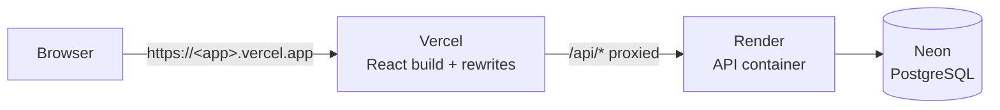

# Deployment (free tier)

The public demo runs on three free services:



| Piece | Service | Free plan notes |
|---|---|---|
| Frontend | [Vercel](https://vercel.com) (Hobby) | Static files on a CDN. `vercel.json` proxies `/api` to Render, so the browser still sees a single origin. |
| API | [Render](https://render.com) (free web service) | Builds `backend/Dockerfile`. **Sleeps after 15 minutes without traffic**; the first request after that takes about a minute while it wakes up. |
| Database | [Neon](https://neon.com) (Free) | Serverless PostgreSQL, 1 GB per project. Unlike Render's free database, it does not expire. |

## 1. Database on Neon

1. Create a Neon account and a project. Region: **AWS US East 2 (Ohio)**, close to the Render region used below.
2. Open **Connect**, turn **Connection pooling off** (the direct connection is the right one for migrations), and copy the connection details.
3. Npgsql expects key/value pairs, not a `postgresql://` URL. Build the string like this:

   ```
   Host=<ep-xxxx>.us-east-2.aws.neon.tech;Database=neondb;Username=<user>;Password=<password>;SSL Mode=Require
   ```

Keep it private: you paste it into Render in the next step and nowhere else.

## 2. API on Render

1. Create a Render account and connect your GitHub account.
2. **New → Blueprint**, pick this repository. Render reads [`render.yaml`](../render.yaml).
3. It asks for the two secrets:
   - `ConnectionStrings__Default`: the Neon string from step 1.
   - `Seed__DemoPassword`: password of the demo account (8+ characters, upper and lower case, a digit). It becomes public if you publish it in the README.
4. Deploy. On startup the API applies the EF Core migrations and creates the demo data.
5. Check `https://<service>.onrender.com/api/health` returns `Healthy`.

`Jwt__SigningKey` is generated by Render. New commits deploy automatically once GitHub Actions passes (`autoDeployTrigger: checksPass`).

## 3. Frontend on Vercel

1. If the Render URL is not `https://jobtracker-api.onrender.com`, replace it in [`frontend/vercel.json`](../frontend/vercel.json) and push.
2. Create a Vercel account, **Add New → Project**, import this repository.
3. Set **Root Directory** to `frontend`. Vercel detects Vite (`npm run build`, output `dist`). No environment variables are needed.
4. Deploy and open the `*.vercel.app` URL.

## How the pieces fit

- **One origin.** The browser only talks to the Vercel domain. `/api/*`, `/scalar` and `/openapi/*` are rewritten to Render, so there is no CORS, and the `HttpOnly`, `Secure`, `SameSite=Strict` refresh cookie works.
- **No cached API data.** Vercel's CDN honors cache headers from proxied origins, and every API response carries `Cache-Control: no-store`, so one user's data can never be served to another.
- **Rate limiting.** Requests reach the API through Vercel and Render's proxy, and the API trusts only the nearest `X-Forwarded-For` hop, which cannot be spoofed. Behind Vercel that hop is a Vercel edge address, so the login limit applies per edge node rather than per person: coarse, but safe for a demo.
- **Cold starts.** If the API is asleep, the first request can time out at the proxy. The app then shows the sign-in page or a "Try again" message; a retry a minute later works.
